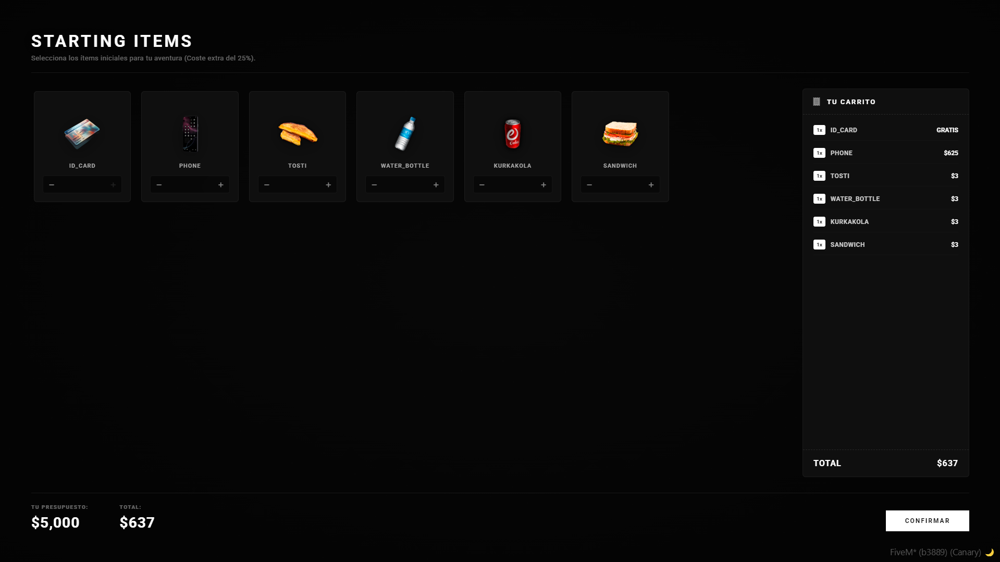
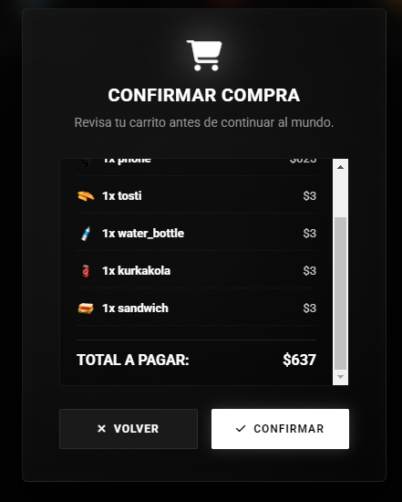
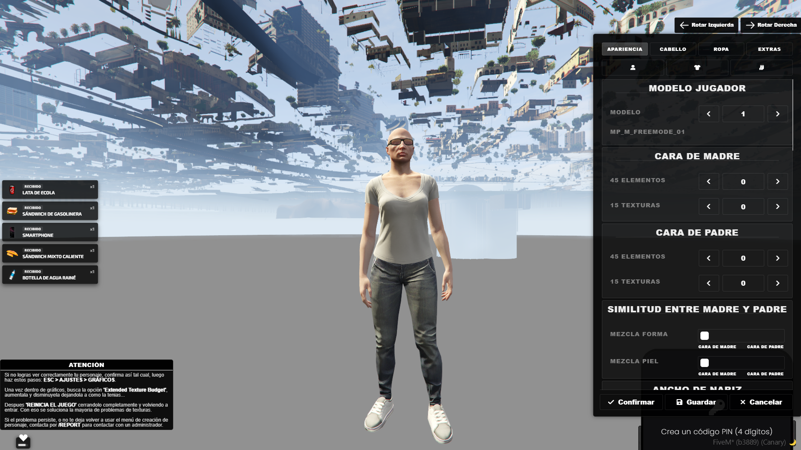
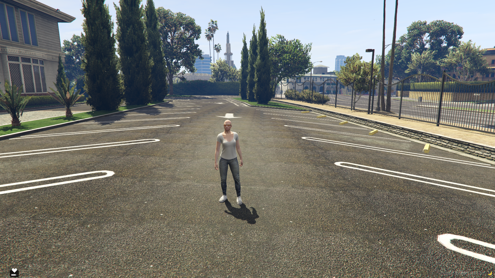
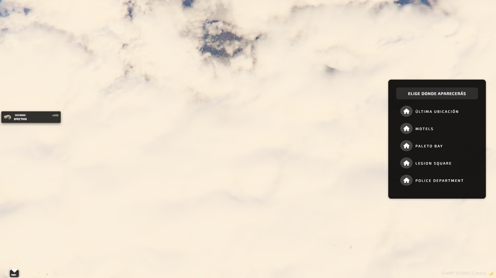
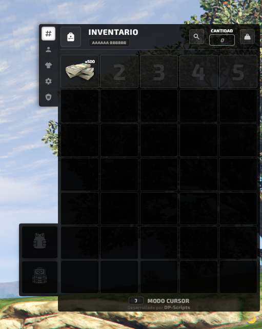

# DP-MultiCharacter

Sistema de selección y creación de personajes para servidores **QBCore** (FiveM), con una interfaz NUI moderna estilo "launcher cinemático" (cámara, siluetas 3D en el mundo, tarjetas de personaje, panel de estadísticas, drag & drop para reordenar, sistema de traducciones, etc.).

---

## 📂 Estructura del proyecto

```
DP-MultiCharacter/
├── client/
│   ├── cl_main.lua      # Cámara, gestión de peds (personajes 3D), zoom/foco, spawn final
│   ├── cl_events.lua    # Entrada al servidor + NUI Callbacks (JS -> Lua)
│   └── cl_utils.lua     # Utilidades editables (notificaciones, integración con qb-clothing)
├── server/
│   ├── sv_main.lua      # Login/registro de personajes en QBCore, spawn, buckets
│   ├── sv_database.lua  # Consultas SQL: listar, borrar y reordenar personajes
│   └── sv_utils.lua     # Ítems/dinero de bienvenida, integraciones externas
├── locales/
│   ├── sistema.lua      # Motor de traducciones (_U() y GetTranslations())
│   ├── es.lua / en.lua / fr.lua / it.lua / de.lua / pt.lua
├── ui/
│   ├── index.html       # Estructura visual (4 pantallas + modal)
│   ├── style.css        # Todo el diseño visual
│   ├── img/              # Fondos (bg1.jpg, bg2.png, bg3.jpg) e imágenes de spawn
│   └── js/
│       ├── app.js        # Lógica principal del frontend (1480 líneas)
│       ├── sounds.js     # Sonidos de interfaz (hover/click)
│       └── validators.js # Validación del formulario de creación de personaje
├── config.lua            # Toda la configuración del recurso
└── fxmanifest.lua        # Manifiesto de FiveM (scripts, ui_page, dependencias)
```

**Dependencia obligatoria:** `qb-core`. También usa `oxmysql` para las queries SQL, y de forma opcional se integra con `qb-clothing`, `DP-Inventory` y `DP-RealMoney` si están presentes.

---

## 🧠 Filosofía general del sistema

1. Al conectarse, el jugador **no aparece en el mapa real**: se le teletransporta a una sala oculta bajo el mapa (`Config.HiddenCoords`) y se activa una interfaz NUI a pantalla completa.
2. En esa sala se generan hasta 7 "peds" (modelos 3D) alineados en fila: uno por cada slot de personaje. Los que ya tienen personaje muestran su skin real; los vacíos muestran una **silueta semitransparente ("sombra")**.
3. El jugador navega la interfaz (landing → lista de personajes → crear/jugar), y mientras lo hace, una cámara cinemática Lua se mueve/hace zoom en sincronía con lo que ocurre en el NUI.
4. Al confirmar "Jugar" o "Crear", la UI se cierra, se destruyen los peds de previsualización, y el servidor hace login/registro real en QBCore y hace aparecer al jugador en el mundo.

---

## 🛠️ `config.lua` — Configuración completa

| Variable | Tipo | Descripción |
|---|---|---|
| `Config.Debug` | bool | Activa logs `[DP-MultiCharacter Debug]` en consola F8 y en consola del servidor. Útil para depurar sin ensuciar la consola en producción. |
| `Config.Locale` | string | Idioma activo (`'es'`, `'en'`, `'it'`, `'fr'`, `'de'`, `'pt'`). |
| `Config.ServerName` | string | Nombre mostrado en la pantalla cinemática al entrar a jugar. |
| `Config.EnableDeleteButton` | bool | Habilita/deshabilita el borrado de personajes desde la UI. |
| `Config.DefaultSlots` | number (1–7) | Slots gratuitos para todos los jugadores. |
| `Config.CustomSlots` | table `[license] = number` | Slots VIP por licencia Rockstar concreta (sobrescribe `DefaultSlots` para esa licencia). |
| `Config.CommandLogOut` | string | Comando de chat para cerrar sesión (`/logout`) y volver al selector. |
| `Config.Interior` | vector3 | Coordenadas del interior que se precarga (`LoadInterior`) para que la sala oculta renderice bien. |
| `Config.HiddenCoords` | vector4 | Coordenadas reales donde se esconde físicamente al jugador mientras ve el menú. |
| `Config.PedCoords` | array de vector4 (5) | Posiciones individuales predefinidas por slot (hasta 7). |
| `Config.PedSpacing` | number | Separación en el eje Y usada para centrar dinámicamente los peds cuando hay más o menos slots que posiciones fijas. |
| `Config.CamCoords` | vector4 | Posición general de la cámara cinemática (vista amplia de todos los personajes). |
| `Config.CharactersAnimations` | bool | Si `true`, los peds en pantalla tendrán animaciones idle en vez de estar estáticos. |
| `Config.CharactersAnimation` | table | Diccionario/nombre de animación para estado `idle` y `select`. |
| `Config.SpawnPoints` | table | `SkipSelection` (bool) + `DefaultSpawn` (vector4) + lista de puntos de spawn con `label`, `description`, `image`, `coords` (para cuando `SkipSelection = false` y se delega en `qb-spawn`). |
| `Config.StartItemsList` | array | Ítems que **debería** recibir un personaje nuevo (actualmente definido pero no consumido directamente por `sv_utils.lua`, que reparte ítems fijos — ver sección de servidor). |
| `Config.ExportCharacters` / `Config.ImportCharacters` | bool | Activan/desactivan (a nivel de config) los botones de exportar/importar personajes en formato "xmt". **Nota:** en el JS actual estos botones existen en la UI pero muestran `alert("Próximamente disponible")`; la lógica real de exportación aún no está implementada. |
| `Config.DefaultMaleModel` / `Config.DefaultFemaleModel` | string | Modelos base (`mp_m_freemode_01` / `mp_f_freemode_01`). |
| `Config.Nationalities` | array de `{label, id}` | Lista completa de países (código ISO de 2 letras) usada para el selector de nacionalidad y para pintar banderas vía `flagcdn.com`. |

---

## ✍️ Personalización rápida

- **Cambiar idioma**: edita `Config.Locale`.
- **Cambiar slots gratuitos / VIP**: `Config.DefaultSlots` y `Config.CustomSlots`.
- **Cambiar ubicación de la sala de selección**: `Config.Interior`, `Config.HiddenCoords`, `Config.PedCoords`, `Config.CamCoords`.
- **Cambiar sistema de ropa**: edita el evento disparado en `cl_utils.lua` (`openClothing`) y las llamadas a `qb-clothing:client:loadPlayerClothing` en `cl_main.lua`.
- **Cambiar dinero/ítems de bienvenida**: edita `GiveStarterItems` en `sv_utils.lua` (y opcionalmente conecta `Config.StartItemsList`, que hoy está definido pero no se usa automáticamente).
- **Activar el selector de spawn nativo de `qb-spawn`** en vez de "última ubicación": pon `SkipSelection = false` dentro de `Config.SpawnPoints`.

---

## 🧩 Integraciones externas (opcionales)

| Recurso | Uso | Obligatorio |
|---|---|---|
| `qb-core` | Framework base (login, personajes, dinero, notificaciones) | ✅ Sí |
| `oxmysql` | Todas las queries SQL | ✅ Sí |
| `qb-clothing` | Cargar y editar la ropa/apariencia del personaje | Recomendado (se llama directamente por nombre de evento) |
| `qb-spawn` | Selector de puntos de spawn cuando `SkipSelection = false` | Solo si no usas `SkipSelection` |
| `DP-Inventory` | Entrega de `id_card` y `phone` al crear personaje | Opcional, falla si no está (revisar `sv_utils.lua`) |
| `DP-RealMoney` | Sincroniza HUD de dinero (cash/black_money/crypto) | Opcional, se detecta automáticamente con `GetResourceState` |

---

## 📜 API para Desarrolladores (Exports)
El script provee funciones abiertas (exports) para que otros recursos de tu servidor puedan interactuar con el sistema de personajes de forma centralizada.

1. Añadir un Evento al Historial del Personaje
Permite registrar hitos importantes (cambios de trabajo, compras, crímenes) en el panel de Historial de Actividad de la pantalla de Opciones del jugador. El historial almacena los últimos 15 eventos en la base de datos (metadata.activityLog).

Sintaxis (Server-side):
```Lua
exports['DP-MultiCharacter']:LogCharacterEvent(source, texto, icono)
```

- source: (Integer) ID del jugador en el servidor.
- texto: (String) El mensaje o descripción del hito que quieres registrar.
- icono: (String) Opcional. Clase del icono de FontAwesome (ej. "fa-info-circle", "fa-briefcase"). Si no se pasa, se usa uno por defecto.

Ejemplo de uso en qb-policejob (cuando contratan a un jugador):
```Lua
-- En el archivo de servidor del trabajo, justo después de actualizarle el 'job' al jugador:
exports['DP-MultiCharacter']:LogCharacterEvent(source, "Contratado como agente en la LSPD.", "fa-user-shield")
```

Ejemplo de uso en un script de robos (al abrir la bóveda):
```Lua
exports['DP-MultiCharacter']:LogCharacterEvent(source, "Participó en el robo al Pacific Standard
```

---

## 🚧 Pendientes por implementar

Lista de trabajo abierta: funcionalidades que hoy están solo como maqueta visual (placeholders, `alert("Próximamente disponible")`, botones sin lógica) o que directamente aún no existen, ordenadas para abordarlas más adelante. Cada punto describe el comportamiento final esperado.

### 1. Comprar Slots
Debe ser funcional de verdad, con dos modos configurables desde `config.lua` (a elección del dueño del servidor):
- **Modo "Coins/VIP in-game"**: se paga con un sistema de monedas ya existente en el servidor. El admin indica en el config el nombre del script de coins:
  - Si es uno de los sistemas ya soportados por `DP-MultiCharacter` de fábrica, basta con poner su nombre.
  - Si es un sistema **custom** propio del servidor, el admin deberá añadir manualmente la integración en `client`/`server` (dejar preparado el punto de enganche, claramente señalado en el código).
- **Modo "URL externa (Google Form / tienda web, etc.)"**: el modal simplemente enlaza a una URL de compra externa; la asignación real de los slots comprados la hace el admin **manualmente** desde archivos/BD tras recibir el pago.

### 2. Exportar Personaje (funcional)
- Encima del recuadro de "código generado", mostrar una lista de los personajes disponibles del usuario, **cada uno con un checkbox**. El usuario debe poder seleccionar entre **2 y 7 personajes** (mínimo 2, máximo 7 = límite máximo de slots del sistema) para exportar de una vez.
- El código generado (en JSON o XML, según el toggle) debe incluir el **detalle completo** de cada personaje seleccionado:
  - ID único de exportación (para poder verificarlo luego al importar).
  - CitizenID, nombre, apellidos, fecha de nacimiento, nacionalidad, género.
  - Economía: dinero en efectivo y en banco.
  - Teléfono.
  - Afiliaciones: trabajo, rango, bandas, si es jefe/líder.
  - Actividad: tiempo jugado, última conexión.
  - Apariencia/personaje: ropa, última ubicación de spawn, cara, tono de piel, pelo, accesorios, etc. — todo.
  - Slot que ocupaba.
- Crear en base de datos una tabla nueva, **`exportacion_multicharacters`**, que guarde estos datos exportados junto a su ID único.
- Botón de "Copiar" debe quedar plenamente funcional (ya lo está a nivel UI, falta el contenido real).

### 3. Importar Personaje (funcional)
- Al pegar el código y pulsar "Importar", el sistema debe:
  1. Buscar en la base de datos (`exportacion_multicharacters`) el registro cuyo ID único coincida (formato: 10 caracteres alfanuméricos, ej. `1G51E3KKA0`).
  2. Verificar que el contenido no haya sido alterado/corrompido respecto al guardado originalmente.
  3. Si es válido, crear ese personaje en la lista de personajes del usuario que importa, asociado a **su propia license**, con todos los datos tal cual se exportaron.
- Caso de uso: un jugador crea y exporta un personaje, se lo pasa a un amigo (Discord, etc.), y al importarlo, el amigo recibe una copia jugable de ese personaje asociada a su cuenta.
- El personaje exportado sigue existiendo también para quien lo exportó; si quiere borrarlo de su propia lista, es decisión suya (borrado normal). Pero **una vez exportado, el registro en `exportacion_multicharacters` no se puede eliminar desde la UI** — solo el owner del servidor puede borrarlo manualmente desde la base de datos.

### 4. Spawn Preferido
Pendiente de revisar más adelante, cuando se implemente un sistema de Spawn propio dentro de `DP-MultiCharacter` (para no depender de tener la lógica repartida en dos scripts distintos como ahora con `qb-spawn`).

### 5. Reportar Bug (funcional + integración con DP-AdminMenu)
- El mensaje que escriba el usuario debe llegar a los administradores a través de `DP-AdminMenu`, soportando tanto texto como imágenes adjuntas.
- Crear un comando configurable en `config.lua`, por ejemplo `/restart-ui [ID del jugador]`, que permita a un admin **reiniciar el script de `DP-MultiCharacter` únicamente para ese jugador concreto** (quitárselo y volver a cargárselo), útil cuando a alguien se le ha bugueado la interfaz o no le cargan cosas correctamente.
- Dejar la puerta abierta a añadir más herramientas de soporte para administradores en el futuro.

### 6. Exportar individual desde la tabla de Opciones
El botón de exportar de cada fila en la tabla debe abrir el **mismo modal** de Exportar/Importar, pero en una variante simplificada: sin el selector de personajes (checklist), ya que aplica únicamente al personaje de esa fila concreta. Solo debe mostrar el selector de Formato (JSON/XML) y el recuadro de código generado con todos los datos de ese personaje.

### 7. Selector de Spawn estilo imágenes del discord
Cuando se desarrolle el sistema de Spawn propio (ver punto 5), debe presentarse como las referencias visuales ya compartida por Discord, alimentada dinámicamente desde `Config.SpawnPoints` (label, descripción, imagen, coords)... El SkipSelection, DefaultSpawn y todo lo demas...

### 8. Mo spawnea donde debe
Cuando creo un personaje de 0 me da los items seleccionados/comprados en el Start Items... la cosa es que NO GUARDA LA ULTIMA POSICION DEL PERSONAJE NI EL INVENTARIO NI NADA, si yo aparezco con ese personaje creado despues de personalizar con el qb-clothing, uso el /logout o salgo y entro del servidor o tiro de restart script, vuelvo a seleccionar ese personaje, NO me pone ese personaje creado en la ultima ubicacion donde lo deje, NO me da esos items que tenia comprados (es como que detecta que es personaje nuevo otra vez y unicamente me da los 5. del banco de nuevo + los 500 en efectivo...), no ah guardado la ropa puesta, no guarda el personaje editado y demas... entonces... que? que coño pasa? tal vez por el Config.Interior porque originalmente el Config.Interior era porque aparecia dentro de un apartamenento y debia salir de dicho departamento para guardar cosas y ahora no porque es un mapeado bajo tierra que siempre es visible y aparece en el campo de golf? o a que se debe? , , , , , 

### 9. Completar todos los locales (traducción íntegra)
Revisar `locales/es.lua` y el resto de idiomas (`en`, `fr`, `it`, `de`, `pt`) para que **absolutamente todo el texto del script** pase por el sistema de traducciones (`_U()` / `data-trans`) — sin textos sueltos hardcodeados en español directamente en el HTML/JS/CLIENTS/SERVERS que se queden sin traducir al cambiar `Config.Locale` (Incluidos los Prints/Console.logs).

### 10. Seguridad — Anti-duplicación en Importar Personaje
Cuando se implemente el punto 4, contemplar el caso de que el **mismo código de importación se use varias veces** (por el mismo usuario o por usuarios distintos a la vez, ej. dos personas pegando el código casi simultáneamente). Definir en `config.lua` si un mismo ID de exportación se puede importar una única vez en total, un número limitado de veces, o de forma ilimitada — y aplicarlo con un lock/transacción en `sv_database.lua` para que no se puedan colar dos importaciones simultáneas del mismo código antes de que la primera termine de procesarse.

### 11. Gestión — Marcar personaje como favorito
El botón "Marcar como favorito" existe visualmente en el roadmap pero no está desarrollado como punto propio. Al marcarlo, ese personaje debe aparecer destacado visualmente en la lista de "Personajes" (por ejemplo con una estrella o borde distinto) y ordenarse primero por defecto en la tabla de Opciones. Guardar el estado de favorito en base de datos (metadata o tabla nueva), asociado al `citizenid`.

### 12. Gestión — Personaje por defecto (independiente del "último usado")
Actualmente el botón "Continuar con tu historia" siempre carga el personaje con el `cid` más bajo (`plyChars[1]`). Permitir que el jugador fije explícitamente **cuál** quiere que sea su personaje por defecto para ese botón, independientemente de cuál usó por última vez o de su número de slot — guardarlo en base de datos y usarlo en `sv_database.lua` al calcular `lastCharacter`.

### 13. Administración — Panel de estadísticas globales del servidor (server-side)
Crear un comando o export pensado para administradores (o integrable en `DP-AdminMenu`) que devuelva estadísticas agregadas del sistema de personajes: número total de personajes activos en el servidor, media de slots usados por jugador, personajes creados en las últimas 24h/7 días, y personajes actualmente en `PROCESO_ELIMINACION` (ver punto 2) pendientes de purga.

### 14. Administración — Log de auditoría de acciones críticas
Registrar en una tabla propia (`multicharacter_audit_log` o similar) cada acción sensible que ocurra: creación, borrado (y quién lo confirmó), reordenamiento, exportación e importación de personajes — con `license`, `citizenid` afectado, timestamp y tipo de acción. Sirve tanto para depurar problemas reportados por jugadores como para que un admin pueda investigar un caso de abuso o duplicación.

### 14. Problemas con los Loading
Cuando yo le doy a un boton que tenga el loading, mientras sale el circulo cargando ese, puedo darle a CUALQUIER OTRO BOTON, OTROS INPUTS, PUEDO HACER OTRAS COSAS mientras carga... eso puede causar problemas, hay que hacer que BLOQUEE todo mientras está cargando con los loadings, porque si le doy por ejemplo a crear personaje, rapido escape que me saca para atras, selecciono otro personaje y le doy a jugar o crear otro, si lo hago rapido, puedo ROMPER EL SCRIPT ENTERO... y no es con lo unico, puedo comprar slots infinitos y acer otras cosas como abrir otros menus o abrir modals, cancelar cosas, duplicar y demas mientras estan cargandose estos LOADINGS...